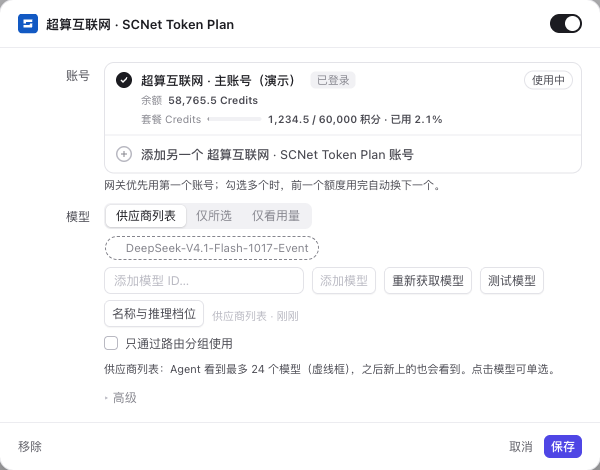

# 超算互联网 · SCNet Token Plan

[English](README.en.md) · [安装 / 更新](#安装与更新) · [浏览器登录](#浏览器登录macos) · [常见问题](#常见问题)

为 [Magpie](https://usemagpie.ai) 接入超算互联网 Token Plan 的开源插件。通过浏览器登录，自动获取账号、现有套餐密钥和额度，支持多账号、活动套餐、自定义模型、流式输出及工具调用。MIT 许可，独立社区项目。

## 配置后的效果

浏览器登录后，账号显示为 **超算互联网 · 用户名 · 套餐**，带独立图标。账号下显示剩余 Credits、已用量和额度进度；套餐到期时间也会交给 Magpie。



*截图来自真实 Magpie 界面的隔离测试，账号及余额均为演示数据，不是实际套餐余额。*

## 安装与更新

打开 Magpie → **插件 → 发现**，搜索 `超算`、`超算互联网` 或 `scnet`。本插件在 **Unofficial, on GitHub（GitHub 非官方插件）** 区域，尚非维护者审核的社区注册表条目。GitHub 简介更新后，Magpie 的列表缓存最多约十分钟；若仍显示旧英文简介，稍后重新进入发现页。也可以直接添加：

```sh
magpie plugin add github:bbingz/scnet-auth
magpie plugin login scnet-token-plan
```

更新已有安装：在 Magpie 的插件页检查更新并更新 `scnet-auth`。新版本为 **0.3.4**。如应用仍使用旧插件代码，在空闲时将此插件关闭再开启。

**从 0.1.x / 0.2.x 升级：** 原账号仍可使用。更新插件后，添加账号并选择下面的浏览器登录。旧匿名/手动账号不会被自动删除；确认新账号的模型与额度后，可用下方的账号管理移除旧账号。再次用同一 SCNet 用户及套餐登录会更新对应的浏览器账号。

## 浏览器登录（macOS）

1. 在 **供应商 → 超算互联网 · SCNet Token Plan → 添加另一个账号**，选择 **浏览器登录超算互联网（macOS 官网）**。
2. Magpie 在当前默认浏览器打开 **SCNet 官方桌面登录页**。正常登录即可，已有登录态也可以使用。macOS 如弹出浏览器钥匙串访问提示，请允许本次读取。
3. 插件自动取得账号名、现有 Token Plan 密钥、套餐和模型，然后打开本机**套餐确认页**。核对账号并点击 **连接到 Magpie**；这里不输入密码或短信验证码。
4. 返回 Magpie 查看账号名称、模型和真实 Credits。多个套餐分别连接，额度按所选套餐展示。

不需要浏览器扩展、独立 Chrome 或复制 Cookie。自动读取目前支持 **macOS 的 Chrome（含 Beta/Dev/Canary）、Edge、Brave**。已实测 Chrome Beta 的真实账号、现有密钥、套餐模型和额度；其他列出的浏览器尚未做真实账号验收。Safari、Windows、Linux 和无桌面环境请使用下方手动方式。

插件只读访问**默认浏览器最近使用的一个资料**，在数据库查询时就限定 `scnet.cn` / `www.scnet.cn` 及控制台所需路径，不扫描其他资料、不复制整个 Cookie 数据库、不读取其他网站、密码或浏览记录。macOS 钥匙串提供该浏览器的 Cookie 解密密钥，仅在本次连接内存中使用，不保存或记录。系统拒绝授权时停止读取，不修改浏览器或系统安全设置。

登录始终在 `https://www.scnet.cn` 完成。后续 `http://127.0.0.1:随机端口/` 页面只确认账号和套餐；只有确认后，SCNet 会话及现有套餐 Key 才保存到本机 Magpie。账号不对时，先在官网切换，再点击 **切换账号后，重新读取**。保存前还会核对身份，防止账号切换期间保存错账号。

模型只使用该订阅 `resourceId` 精确匹配的套餐；未返回模型时才要求补填完整 ID。不会创建或重置密钥、购买套餐。没有可用套餐/完整密钥时明确提示。

请在 Magpie 所在电脑、默认浏览器的普通窗口中完成登录；无痕窗口的会话无法读取。取消或五分钟超时后停止读取并清理内存中的解密密钥，未确认的凭据不保存。确认页刷新后需要重新发起连接。SCNet 会话过期时重新登录即可，额度查询失败不会使推理密钥失效。

## 手动配置（高级 / 无桌面环境）

选择 **手动配置 API Key（高级 / 无桌面环境）** 后进入下面的中文向导。

在 **供应商 → 添加供应商 → 来自插件 → 超算互联网 · SCNet Token Plan** 中配置，或使用上面的登录命令。

| 步骤 | 怎么填写 |
| --- | --- |
| 账号备注 | 如“主账号”“工作账号”。显示为“超算互联网 · 主账号”。同名登录更新原账号，不同账号请使用不同名称。不要填写密钥。 |
| 模型配置 | **DeepSeek 活动套餐（Event）** 自动使用 `DeepSeek-V4.1-Flash-1017-Event`；其他套餐选择 **其他套餐 / 自定义模型**。 |
| 自定义模型 | 从该套餐控制台复制完整模型 ID，支持中英文逗号或换行分隔，自动去重。保留日期及 `-Event` 后缀。 |
| 剩余额度 | **连接额度查询**：继续填写控制台 Cookie 并选择套餐；**暂不查询额度**：直接进入 API Key 步骤。 |
| 套餐选择 | 从当前控制台账号的套餐列表中，选中**与即将填写的 API Key 对应的套餐**。只显示所选套餐额度，不合并其他套餐。 |
| 专用 API Key | 粘贴 Token Plan 页的套餐专用 Key，输入会遮罩。普通按量付费 Key 不使用套餐额度。 |

登录后，在 Agent 的 Magpie 模型列表中选择：

```text
scnet-token-plan/DeepSeek-V4.1-Flash-1017-Event
```

如果使用其他套餐，选择自己填写的模型 ID。保存 Key 只代表完成本地配置，第一次模型请求才会检验 SCNet 的实际鉴权和模型权限。

## 手动连接额度查询（高级）

浏览器登录已自动连接额度，无需执行本节。以下仅用于高级手动配置。

SCNet 的模型 API Key 与网页登录会话用途不同。当前接入的是 **SCNet 控制台自身的套餐查询接口**，需要 Cookie；这是控制台内部接口，可能随网站更新而变化。

1. 在自己的浏览器登录 [SCNet Token Plan 控制台](https://www.scnet.cn/ui/console/index.html#/llm/token-plan)。
2. 打开开发者工具（macOS：`⌥⌘I`；Windows/Linux：`F12`），进入 **Network / 网络**。
3. 刷新控制台，在网络请求中过滤 `tokenplan/list`。
4. 点击该请求 → **Headers / 标头 → Request Headers / 请求标头 → Cookie**，复制它的**值**。不要复制 `Cookie:` 标签、响应的 `Set-Cookie` 或整段 cURL。
5. 在插件的遮罩输入框中粘贴，选择对应套餐，然后填写套餐 API Key。

Cookie 是登录凭据，请仅粘贴到本机 Magpie 的配置框，不要发到 Issue、聊天或截图中。插件把它保存在该账号的 Magpie 凭据文件中，只发送到固定的 SCNet HTTPS 套餐查询地址，不用于推理、不跟随重定向、不写日志。查询不消耗模型推理额度。

查询结果包含剩余 Credits、已用 / 总额、使用百分比及返回的到期时间。SCNet 返回明确的重置时间时才显示重置，不假设自动续订。**Credits 不等于 token 数量**，也不由 Magpie 的本地 token 统计估算。

未连接时提示使用“浏览器登录超算互联网”。Cookie 过期、网络失败或套餐数据不完整时会显示具体原因，不伪造余额、不把模型 API Key 标记为失效。重新登录时使用原账号备注，更新 Cookie 并再次选择套餐即可。

套餐和模型由你按控制台选择；插件不能用控制台 Cookie 自动证明该套餐与某个 API Key 属于同一账号。

## 常见问题

**仍显示 `API key …` 或“剩余额度未知”？**

先确认插件版本为 0.3.4，再选择浏览器登录完成账号连接。旧账号没有新增的备注、Cookie 和套餐选择信息。没有连接额度查询时仍可正常使用模型。

**旧 KEY 没有“移除”按钮，怎么自己删除？**

0.3.4 在插件自己的选项中提供账号管理，不需要修改或升级 Magpie 本体：

1. 打开「超算互联网」供应商，点击「添加另一个账号」。
2. 选择 **管理已保存账号（移除旧 KEY）**，再选择要删除的那条记录。
3. 核对名称或 Key 尾号，点击 **确认移除这个账号**。确认前点「取消」不会删除。
4. 看到「已移除」后点「取消 / Cancel」关闭管理，重新打开供应商查看。

这个入口只管理已有记录，不会新建账号、打开浏览器或要求再次登录。首个及最后一个账号都可移除；只清除所选记录的本机 Key 和 Cookie，不撤销官网 Key、不影响其他账号。即使两条记录使用相同的 Key，也只删除选中的一条。移除最后一个账号后，此供应商暂时不再提供模型；需要时可以重新添加。

**登录后请求 401 / 403 / 429？**

核对专用 Key、订阅状态、模型完整 ID 和控制台额度。服务端错误会原样交给 Magpie，便于重试和账号切换。额度查询的会话过期与推理 Key 失效分别处理。

**为什么不自动添加全部模型？**

SCNet 公共 `/models` 接口描述的是平台模型目录，不是某个账号的套餐权益。本插件仅暴露你选择的模型，避免误用不属于套餐的模型。

**上下文和输出上限怎么设？**

未核实的上限保留为 `0`（未指定）。如果你已从 SCNet 确认，可以在 Magpie 插件配置中设置对应模型的 `limit.context` 和 `limit.output`；插件保留已有配置。

**怎么停用额度查询 / 移除插件？**

使用相同账号备注重新登录，选择“暂不查询额度”，即可清除该次配置中保存的 Cookie。移除整个供应商的账号及插件：

```sh
magpie plugin logout scnet-token-plan
magpie plugin rm github:bbingz/scnet-auth
```

## 接口与凭据

| 项目 | 值 |
| --- | --- |
| Provider ID | `scnet-token-plan` |
| 模型 Base URL | `https://api.scnet.cn/api/llm/v1` |
| 推理地址 | `https://api.scnet.cn/api/llm/v1/chat/completions` |
| 额度地址 | `https://www.scnet.cn/acx/charge/account/currentuser/tokenplan/list` |
| 凭据位置 | `$XDG_CONFIG_HOME/magpie/plugin-auth.json`，默认 `~/.config/magpie/plugin-auth.json` |

插件使用 Magpie 的 OpenCode 插件接口。上游使用 Chat Completions，由 Magpie 转换 OpenAI Chat、Responses 和 Anthropic Messages；无需为每种协议重复添加模型。浏览器登录仅使用 Node.js 内置 HTTP 和 Fetch，不依赖 Playwright 或浏览器扩展，无需构建。主要面向 Magpie，动态套餐向导及密钥遮罩输入为 Magpie 扩展，未验证原生 OpenCode。

## 开发与验证

```sh
npm ci --ignore-scripts
npm test
npm pack --dry-run --ignore-scripts
# macOS，安装 Magpie 与 Bun 后：
SCNET_TEST_BUN=/absolute/path/to/bun npm run test:magpie
# 启动隔离的真实 Magpie 界面，使用模拟上游：
SCNET_TEST_UI=1 SCNET_TEST_BUN=/absolute/path/to/bun npm run test:magpie
```

单元测试覆盖账号名称、条件向导、模型列表、额度解析及失败处理、密钥隔离、流式工具调用、注销及取消。集成测试覆盖真实 CLI 安装 / 登录 / 套餐选择 / 额度显示，以及三种协议的 JSON/SSE 和文本/工具调用。测试使用临时目录、假凭据和 macOS 沙箱，不读取或修改现有账号。真实账号曾通过旧版完成一次推理；新版浏览器登录及真实余额仍需单独验收，模拟结果不代表真实余额。

## 参考

- [Magpie 插件指南](https://usemagpie.ai/docs/plugins)
- [SCNet Token Plan 文档](https://www.scnet.cn/help/docs/mainsite/mass/plans/token-plan.html)
- [SCNet 模型列表 API](https://www.scnet.cn/help/docs/mainsite/mass/api/modulequery.html)
- [额度接口来源及验证边界](docs/quota-api.md)
